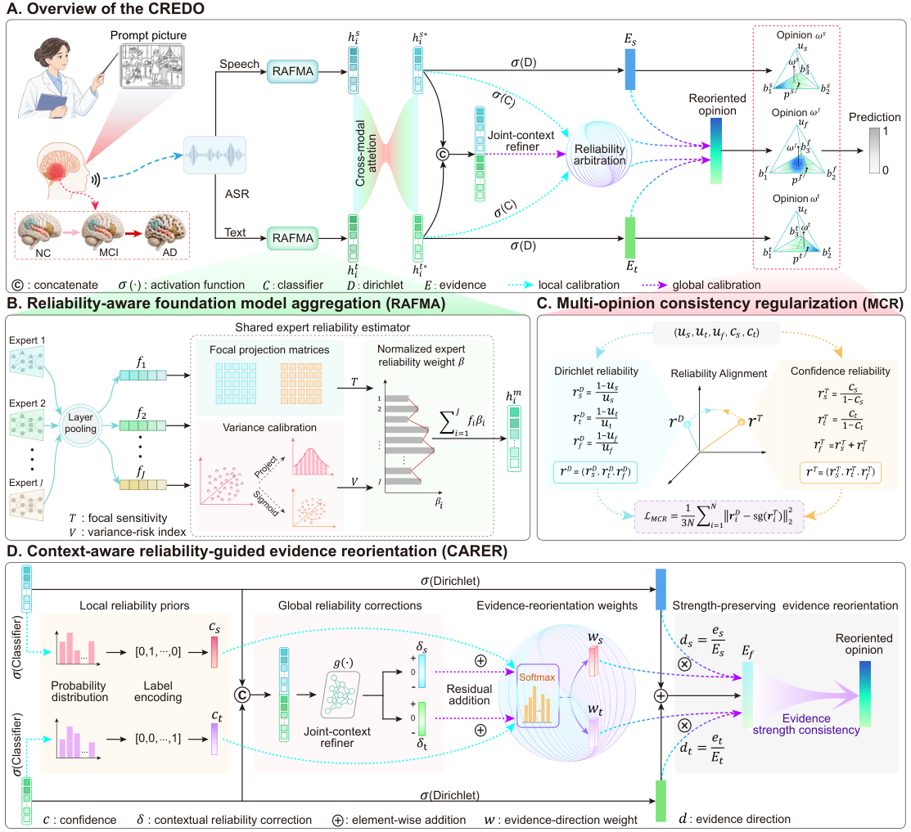

# CREDO

**CREDO: Contextual Reliability across Experts and Dirichlet Opinions for Speech-Based Cognitive Impairment Detection**

**Authors:** Lili Zheng, Wenxin Li, Qi Shao, Sichen Li, Yue Hua, Chen Jason Zhang, Shan Cong, Xiaohui Yao, Hong Liang, and Haoran Luo.

This repository presents the CREDO framework, research code organization, preprocessing and training workflows, and supplementary information.

Supplementary material: [Supplementary_CREDO.pdf](Supplementary_CREDO.pdf).

## Overview

Speech-based cognitive impairment classification benefits from complementary acoustic and linguistic information, but pretrained experts and modalities may differ in reliability across individuals. **CREDO** learns sample-specific reliability during expert aggregation and uses local confidence and joint speech–text context to guide Dirichlet evidence fusion.



*Figure 1. CREDO combines (A) speech–text processing and prediction, (B) reliability-aware foundation model aggregation (RAFMA), (C) multi-opinion consistency regularization (MCR), and (D) context-aware reliability-guided evidence reorientation (CARER).*

A vector version of this figure is also available: [Framework figure (PDF)](assets/fig_framework.pdf).

## Abstract

CREDO is a reliability-aware framework for speech-based cognitive impairment classification. It estimates subject-specific expert reliability from learned latent variance and focal sensitivity, adaptively aggregates pretrained speech and language representations, and incorporates bidirectional cross-modal attention. At the decision level, local estimates of true-class confidence and global speech–text context control how modality-specific evidence directions are combined while preserving total evidence strength. Multi-opinion consistency regularization aligns confidence-based and evidential reliability assessments. The study investigates classification performance, input-perturbation robustness, and cross-dataset generalization on four public benchmarks and an independent cohort.

## Key contributions

- **Reliability-aware foundation model aggregation (RAFMA):** weights pretrained acoustic and linguistic experts according to sample-specific reliability estimated using latent-variance calibration and focal sensitivity.
- **Cross-modal attention:** refines speech and text representations using bidirectional expert interactions.
- **Context-aware reliability-guided evidence reorientation (CARER):** combines local confidence priors with global context corrections to redistribute class-wise Dirichlet evidence without changing the summed evidence strength.
- **Multi-opinion consistency regularization (MCR):** encourages agreement between confidence-derived and Dirichlet-derived modality/fused reliability scores.

## Datasets and tasks

| Dataset | Language | Classification task |
| --- | --- | --- |
| ADReSS | English | NC vs. AD |
| ADReSSo | English | NC vs. AD |
| TAUKADIAL | English and Chinese | NC vs. MCI |
| NCMMSC | Chinese | NC vs. AD |
| SMU-Cog (external cohort) | Chinese | NC vs. (MCI + AD) |

The independent SMU-Cog cohort is used for external evaluation only; its recordings and participant-level data are **not distributed**. Refer to the supplementary information for task definitions and evaluation protocols. Users must obtain the public corpora through their respective authorized channels and comply with their licenses and consent conditions.

## Code organization and correspondence to the paper

| Paper component / task | Source path |
| --- | --- |
| Speech expert feature extraction | `script/extract_speech_layered_features_v2.py` |
| Text expert feature extraction (reference-only script) | `script/extract_text_layered_features_reference_only.py` |
| Layered feature manifest preparation | `script/prepare_v2_layered_manifest.py` |
| Cached multimodal feature construction | `script/build_dca_moe_cached_features_v2.py` |
| Cached dataset loading | `src/datasets/dca_moe_cached_dataset.py` |
| Five-fold training and evaluation | `script/train_cv5_shared_clens_confidence_routed_v2_fixed.py` |
| RAFMA, cross-modal interaction, CARER, and MCR model logic | `src/models/dca_moe_shared_clens_confidence_routed_v2.py` |

**Naming:** Internal script identifiers such as `dca_moe`, `shared_clens`, `ucra`, and `lambda_seoc` reflect the development history of the implementation. The paper uses **RAFMA**, **CARER**, and **MCR**.

## Repository structure

```text
CREDO/
├── README.md
├── .gitignore
├── requirements.txt
├── Supplementary_CREDO.pdf
├── assets/
│   ├── fig_framework.png
│   └── fig_framework.pdf
├── script/
│   ├── build_dca_moe_cached_features_v2.py
│   ├── extract_speech_layered_features_v2.py
│   ├── extract_text_layered_features_reference_only.py
│   ├── prepare_v2_layered_manifest.py
│   └── train_cv5_shared_clens_confidence_routed_v2_fixed.py
└── src/
    ├── datasets/
    │   └── dca_moe_cached_dataset.py
    └── models/
        └── README.md   # Model architecture and component overview
```


## Installation

A Python environment with a CUDA-enabled PyTorch installation is recommended for GPU feature extraction and training (the supplied scripts were developed for PyTorch/Transformers-based workflows). Install a compatible PyTorch build for your machine first, then:

```bash
python -m venv .venv
source .venv/bin/activate  # On Windows: .venv\Scripts\activate
pip install -r requirements.txt
```

The code was supplied with machine-specific defaults under `/data1/haoran_moe/`. **You must supply your own local manifests, output folders, and pretrained-model paths**; those referenced paths are not included in this repository. Review the CLI help of each script for accepted options. No pretrained weights, audio files, transcripts, feature caches, or participant data are included.

## Data preparation (illustrative workflow)

The actual CSV schema and expected tensor objects are defined by the scripts; inspect those implementations before preparing your inputs. Paths below are placeholders, not distributed example data.

1. Prepare an authorized dataset manifest containing speech paths, transcript information, dataset identifiers, and participant identifiers as required by the scripts.
2. Extract layered speech features (provide local pretrained encoder directories):

```bash
python script/extract_speech_layered_features_v2.py \
  --manifest /path/to/manifest.csv \
  --save_root /path/to/features/speech_layered \
  --wav2vec2_model /path/to/wav2vec2_large \
  --wavlm_model /path/to/wavlm-large \
  --hubert_model /path/to/hubert-large-ls960-ft \
  --dataset ADReSS \
  --device cuda
```

3. The `extract_text_layered_features_reference_only.py` file is supplied for reference. It defines internal pretrained text model locations; adapt its local model configuration before use.
4. Generate an updated layered-feature manifest and construct the cached examples:

```bash
python script/prepare_v2_layered_manifest.py \
  --base_manifest /path/to/base_manifest.csv \
  --new_speech_root /path/to/features/speech_layered \
  --output_manifest /path/to/layered_manifest.csv \
  --dataset ADReSS

python script/build_dca_moe_cached_features_v2.py \
  --manifest /path/to/layered_manifest.csv \
  --save_root /path/to/features/cached \
  --output_manifest /path/to/cached_manifest.csv
```

These commands demonstrate script entry points only: successful execution requires matching input schema, pretrained models, and existing text-layer features.

## Training

The training workflow supports participant-aware five-fold evaluation and repeated seeded runs. Example parameters include 5 folds, 20 runs, and a split seed of 2026. Configure dataset manifests and pretrained model paths for your environment:

```bash
python script/train_cv5_shared_clens_confidence_routed_v2_fixed.py \
  --manifest /path/to/cached_manifest.csv \
  --output_dir /path/to/outputs \
  --dataset ADReSS \
  --folds 5 \
  --runs 20 \
  --epochs 100 \
  --split_seed 2026 \
  --train_seed_base 43 \
  --best_metric f1 \
  --device cuda
```


## Supplementary material

[Supplementary_CREDO.pdf](Supplementary_CREDO.pdf) documents additional dataset and evaluation details, including the external SMU-Cog collection workflow and post-hoc word-masking interpretation. 

## Citation

The manuscript has not been published in the materials supplied here. Please cite the paper **after its publication** using the final bibliographic information. No journal, DOI, acceptance status, or BibTeX entry is claimed at this stage.

## Responsible use

This research code is intended for scientific investigation and benchmarking, not standalone medical diagnosis or clinical decision-making. Dataset-specific permissions and participant privacy restrictions must be respected.
